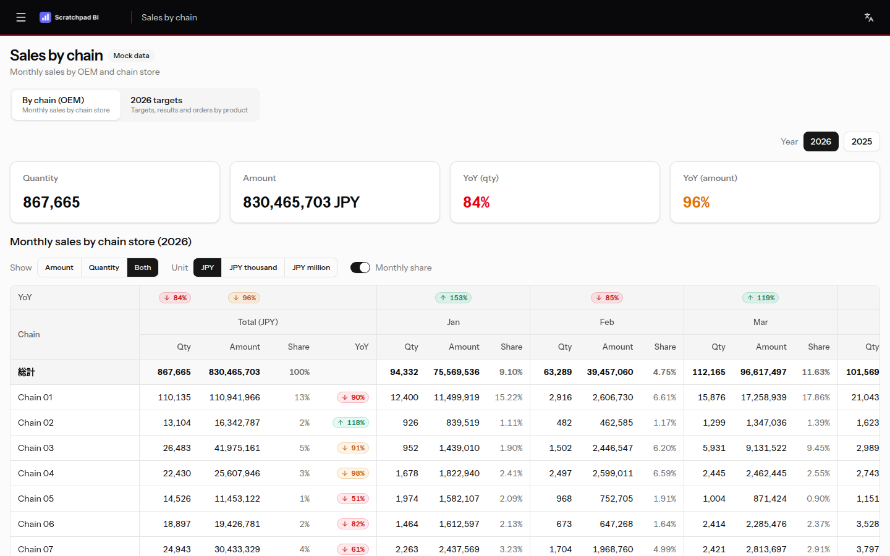
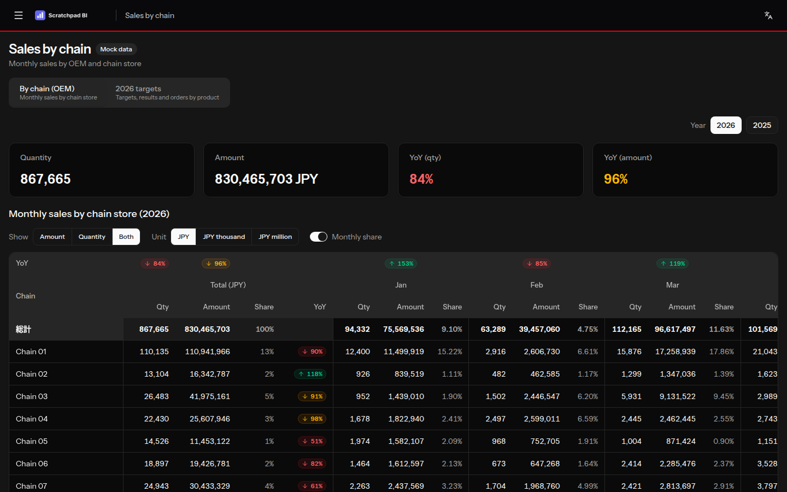
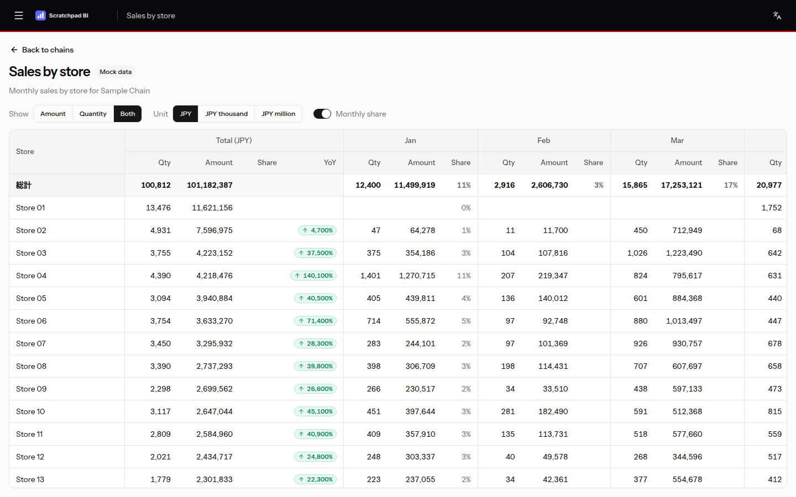
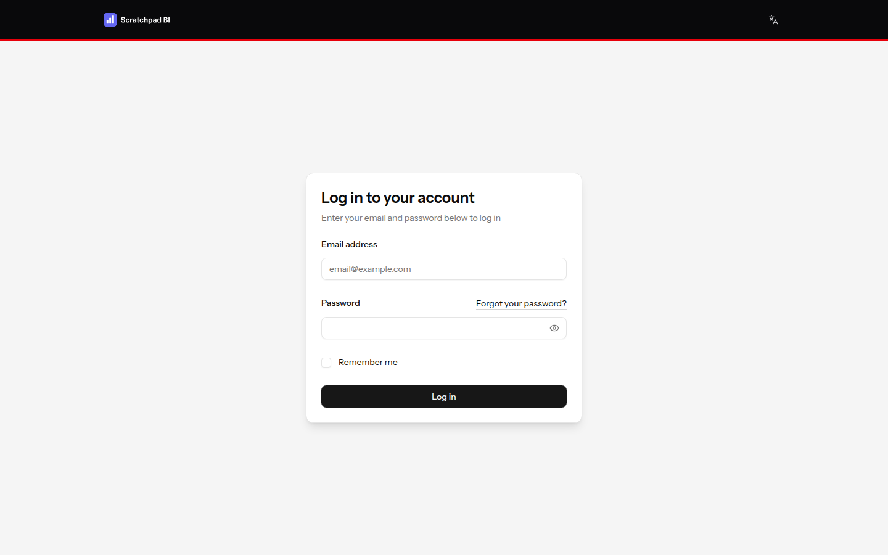

<div align="center">


# Scratchpad BI

Laravel、Inertia、Vue で構築した BI（ビジネスインテリジェンス）Web アプリです。すべて Docker Compose 上で動作します。

[](LICENSE)


[English](README.md) · [Tiếng Việt](README.vi.md) · **日本語**

</div>

## 目次

- [機能](#機能)
- [スクリーンショット](#スクリーンショット)
- [技術スタック](#技術スタック)
- [クイックスタート](#クイックスタート)
- [動作要件](#動作要件)
- [ホストのポート](#ホストのポート)
- [日常のコマンド](#日常のコマンド)
- [プロジェクト構成](#プロジェクト構成)
- [AIツールのセットアップ](#aiツールのセットアップ)
- [トラブルシューティング](#トラブルシューティング)
- [コントリビュート](#コントリビュート)
- [ライセンス](#ライセンス)

## 機能

- チェーン別・店舗別・商品別の売上レポート（`/dashboard`、`/sales/stores`、`/sales/products`）。
- 固定列と横スクロールに対応した HTML テーブルによる BI テーブル。意味に基づく色分け（positive、negative、warning、neutral、actual、target、forecast）。
- Laravel Fortify による認証：ログイン、パスワードリセット、メール認証、二要素認証（2FA）。
- 設定ページ：プロフィール、セキュリティ、外観（ライト/ダーク）。
- 多言語 UI：日本語（デフォルト）と英語。
- 1 コマンドで開発環境を構築：`make setup`。

## スクリーンショット

表示されているデータはモックデータです。チェーン名、店舗名、商品名は匿名化しています。



| ダークテーマ | 店舗別売上 |
| --- | --- |
|  |  |



## 技術スタック

| レイヤー | 技術 |
| --- | --- |
| バックエンド | Laravel 13、PHP 8.3+、Laravel Fortify、Laravel Wayfinder |
| フロントエンド | Inertia 3、Vue 3（TypeScript）、shadcn-vue（reka-ui）、Tailwind CSS 4、vue-i18n、Vite |
| データ | MySQL 8.4、Redis 7（キャッシュ、セッション、キュー） |
| インフラ | Docker Compose、`make` |

## クイックスタート

```bash
git clone https://github.com/nhhthong/scratchpad-bi.git
cd scratchpad-bi
make setup
```

`make setup` は次の手順を順に実行します。

1. `.env.example` から `.env` を作成し、自分の `UID`/`GID` と MySQL・Redis のランダムなパスワードを設定します（`.env` が既にある場合はそのまま残します）。
2. ホストのポートが空いているか確認します。
3. イメージをビルドし、`vendor/` と `node_modules/` をインストールし、`APP_KEY` を生成してマイグレーションを実行します。
4. スタックを起動します。

初回は数分かかります（イメージと依存パッケージのダウンロード）。完了したら <http://localhost:8090> を開いてください（`APP_PORT` を変更した場合はそのポートを使います）。

初回インストール時の `UID`/`GID` が誤っていて `vendor/` や `node_modules/` の所有者が root になった場合は、`sudo chown -R $(id -u):$(id -g) vendor node_modules` を実行し、`.env` の `UID`/`GID` を修正してから、`make build` を実行して再インストールしてください。

## 動作要件

| ツール | 用途 | 備考 |
| --- | --- | --- |
| Docker + Docker Compose v2 | スタック全体の実行 | 動作確認済み：Docker 29.8.2、Compose 5.6.0 |
| `make`、`openssl`、`ss` | `Makefile`（セットアップ、ショートカット） | Ubuntu に標準で含まれます |
| Git | リポジトリのクローン | |
| Node.js（`npx` 付き） | `shadcn` MCP サーバーの実行のみ | 任意。動作確認済み：24.x |
| Claude Code | AI エージェント | 任意。`AGENTS.md` を読み込むには 2.1.277 以上が必要 |

ホストに PHP、Composer、pnpm をインストールする必要はありません。すべてのコマンドはコンテナ内で実行されます。`vendor/` と `node_modules/` はホストからバインドマウントされるため、IDE はコンテナ内にインストールされた正確なバージョンを直接参照できます。

> [!NOTE]
> このバインドマウント構成は Linux 専用です。macOS や Windows では名前付きボリュームに切り替えてください。ネイティブバイナリ（`esbuild`、`rollup`）は OS ごとに異なり、バインドマウントは低速です。

スタックは 3 つのコンテナで構成されます。マシン起動時には自動で起動しません（`restart: 'no'`）。

| コンテナ | 実行内容 |
| --- | --- |
| `bi-ygk-app` | `php artisan dev`：Web サーバー、キューワーカー、ログビューア（Pail）、Vite を 1 つのコンテナで実行し、クラッシュしたプロセスを自動で再起動します |
| `bi-ygk-mysql` | MySQL 8.4。データはボリューム `bi-ygk_mysql_data` に保存されます |
| `bi-ygk-redis` | キャッシュ、セッション、キュー用の Redis 7（ディスクへの永続化なし） |

## ホストのポート

デフォルト値は `.env` にあります。

| サービス | ホストのポート | 変数 |
| --- | --- | --- |
| アプリ（Web サーバー） | 8090 | `APP_PORT` |
| Vite 開発サーバー / HMR | 5180 | `VITE_PORT` |
| MySQL（`127.0.0.1` のみ） | 3310 | `MYSQL_FORWARD_PORT` |
| Redis（`127.0.0.1` のみ） | 6380 | `REDIS_FORWARD_PORT` |

`make ports` は `.env` の 4 つのポートを確認します（`make setup` が自動で実行します）。ポートが使用中の場合は、他のサービスを止めずに `.env` を変更してください。コンテナ同士はホストのポートではなくサービス名（`mysql:3306`、`redis:6379`）で通信します。

## 日常のコマンド

全コマンドは `make help` で確認できます。よく使うコマンド：

```bash
make up            # スタックを起動
make down          # スタックを停止（データは保持）
make ps            # コンテナの状態
make logs          # サーバー、キュー、Pail、Vite のログ
make shell         # app コンテナ内で bash を開く
make test          # PHP テスト（SQLite :memory:、MySQL には触れません）
make types         # TypeScript の型チェック
make check         # lint + フォーマットチェック
make build-assets  # 本番ビルド
make migrate       # マイグレーションを実行
make mysql         # MySQL シェル
make restart       # アプリを再起動（vite.config.ts や .env を編集した後）
```

パッケージの追加：

```bash
docker compose exec app composer require <pkg>
docker compose exec app pnpm add <pkg>
```

ソースコードはホスト上にあり、コンテナにバインドマウントされるため、編集はすぐに反映されます。Vite の HMR はポーリングなしで動作します。HMR が変更を取りこぼす場合のみ `VITE_USE_POLLING=true` を設定してください。

`vite.config.ts` を編集した後は `make restart` を実行してください。Vite は自動で再起動しますが、再起動のたびに約 200 MiB のメモリが解放されずに残ります。

> [!WARNING]
> ボリューム `bi-ygk_mysql_data` に対して `docker compose down -v`、`docker volume rm`、`docker system prune` を実行しないでください。MySQL のデータが失われます。

## プロジェクト構成

Laravel と Vue の標準的なディレクトリ構成を使用しています。

```text
app/{Actions,DTOs,Enums,Http,Models,Policies,Services}
resources/js/{pages,layouts,components/{ui,tables,shared},composables,lib,types,utils}
docker/php/Dockerfile     compose.yaml     Makefile     .env.example
.claude/{rules,settings.json}     .mcp.json     AGENTS.md
```

## AIツールのセットアップ

このセクションは任意で、Claude Code を使う開発者向けです。次のファイルはコミット済みで、クローン後すぐに使えます：`AGENTS.md`、`.claude/rules/`、`.claude/settings.json`、`.mcp.json`、`config/boost.php`。

1. Laravel Boost の skills を生成します（git には含まれません）。`--skills` のみを使用してください：

   ```bash
   docker compose exec app php artisan boost:install -n --skills
   ```

   `--guidelines` は付けないでください（長い Boost ブロックが `AGENTS.md` に書き込まれます）。`--mcp` も付けないでください（`.mcp.json` の `laravel-boost` エントリが、ホスト上で動く `php artisan boost:mcp` に上書きされ、この環境では動作しません）。

2. リポジトリのルートで Claude Code を開き、`/mcp` を実行して、表示される 2 つのサーバーを承認します：
   - `laravel-boost`：`app` コンテナ内で実行されます（`docker compose exec -T app php artisan boost:mcp`）。スタックが起動している必要があります。
   - `shadcn`：`npx shadcn-vue@latest mcp` を実行します。以前に拒否した場合は、`claude mcp reset-project-choices` を実行して開き直してください。
3. `/memory` を実行し、`AGENTS.md` と `.claude/rules/` 内のファイルが読み込まれていることを確認します。

`boost.json` と `.claude/skills/` は自動生成され、`.gitignore` に含まれています。`.claude/settings.json` の `ask` ルールにより、破壊的なコマンド（`docker compose down`、`docker volume rm`、`docker system prune`、`migrate:fresh`、`db:wipe`、`FLUSH*`）の実行前に確認が求められます。

任意：`codebase-memory-mcp` MCP サーバーでソースコードをインデックス化できます（`index_repository`）。インデックスは各開発者のマシン上に保存され、リポジトリには含まれません。

## トラブルシューティング

| 症状 | 対処 |
| --- | --- |
| `port is already allocated` | `.env` の該当するポートを変更し、`make up` を実行します |
| 初回起動が遅い（約 1 分） | `php artisan dev` が `pnpm dlx` で `@laravel/multiplex` を 1 回ダウンロードし、ボリューム `bi-ygk_app_cache` にキャッシュします。2 回目以降は約 2 秒です |
| 白紙のページ、CSS/JS が読み込まれない | `make logs` を実行し（`vite │` の行を確認）、`public/hot` の内容が `http://localhost:<VITE_PORT>` であることを確認します |
| コンテナ内で作成したファイルの所有者が root になる | `.env` に正しい `UID`/`GID` を設定し、`docker compose build` を実行します |
| `/mcp` で `laravel-boost` に接続できない | `make up` を実行し、`docker compose exec -T app php artisan boost:mcp` を試します |
| `.env` を編集した後に MySQL のパスワードが合わなくなった | MySQL はボリュームの初回作成時にのみパスワードを読み込みます。`.env` を編集せず、SQL で変更してください |

## コントリビュート

コントリビュートを歓迎します。

1. リポジトリをフォークし、`main` からブランチを作成します。
2. コマンドは Docker 内で実行してください。ホスト上で `php`、`composer`、`pnpm` を実行しないでください（[AGENTS.md](AGENTS.md) を参照）。
3. プルリクエストを開く前に `make test`、`make types`、`make check` を実行してください。3 つすべてが成功する必要があります。
4. プルリクエストには、変更内容とその理由を記載してください。

## ライセンス

MIT ライセンスで公開しています。詳細は [LICENSE](LICENSE) を参照してください。
