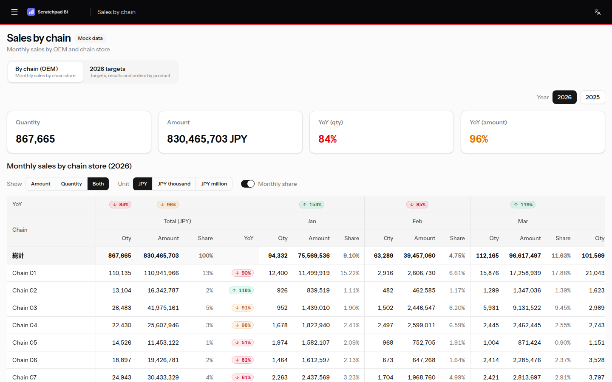
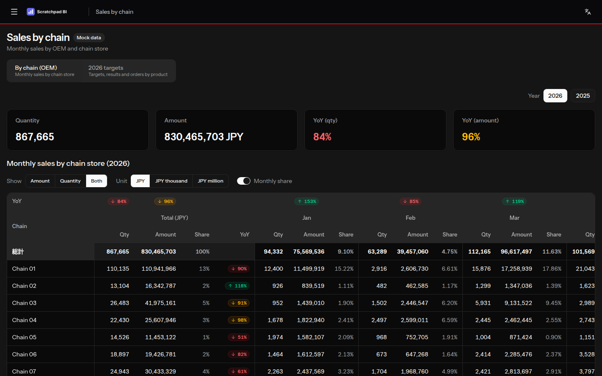
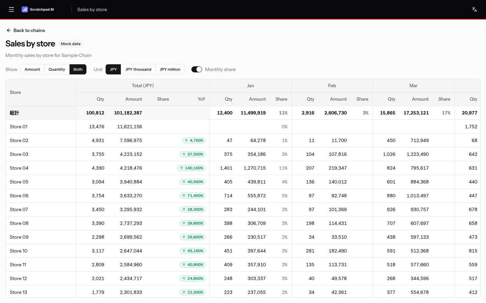
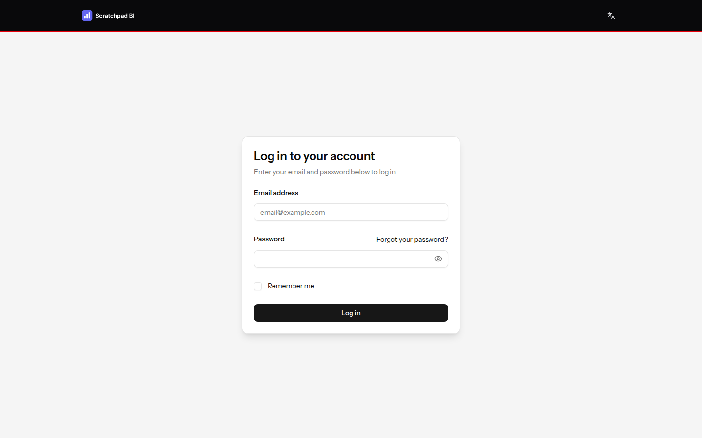

<div align="center">


# Scratchpad BI

A business intelligence (BI) web app built with Laravel, Inertia and Vue, running entirely on Docker Compose.

[](LICENSE)


**English** · [Tiếng Việt](README.vi.md) · [日本語](README.ja.md)

</div>

## Table of contents

- [Features](#features)
- [Screenshots](#screenshots)
- [Tech stack](#tech-stack)
- [Quick start](#quick-start)
- [Requirements](#requirements)
- [Host ports](#host-ports)
- [Daily commands](#daily-commands)
- [Project structure](#project-structure)
- [AI tooling setup](#ai-tooling-setup)
- [Troubleshooting](#troubleshooting)
- [Contributing](#contributing)
- [License](#license)

## Features

- Sales reports by chain, store and product (`/dashboard`, `/sales/stores`, `/sales/products`).
- BI tables built as plain HTML tables with sticky columns and horizontal scrolling, with semantic colors (positive, negative, warning, neutral, actual, target, forecast).
- Authentication with Laravel Fortify: login, password reset, email verification and two-factor authentication (2FA).
- Settings pages: profile, security and appearance (light/dark).
- Localized UI: Japanese (default) and English.
- One-command development environment: `make setup`.

## Screenshots

The data shown is mock data. Chain, store and product names are anonymized.



| Dark theme | Sales by store |
| --- | --- |
|  |  |



## Tech stack

| Layer | Technology |
| --- | --- |
| Backend | Laravel 13, PHP 8.3+, Laravel Fortify, Laravel Wayfinder |
| Frontend | Inertia 3, Vue 3 (TypeScript), shadcn-vue (reka-ui), Tailwind CSS 4, vue-i18n, Vite |
| Data | MySQL 8.4, Redis 7 (cache, session, queue) |
| Infrastructure | Docker Compose, `make` |

## Quick start

```bash
git clone https://github.com/nhhthong/scratchpad-bi.git
cd scratchpad-bi
make setup
```

`make setup` runs these steps in order:

1. Creates `.env` from `.env.example`, fills in your `UID`/`GID` and random passwords for MySQL and Redis (an existing `.env` is kept as is).
2. Checks that the host ports are free.
3. Builds the image, installs `vendor/` and `node_modules/`, generates `APP_KEY` and runs the migrations.
4. Starts the stack.

The first run takes a few minutes (image and dependency downloads). When it finishes, open <http://localhost:8090> (use a different port if you changed `APP_PORT`).

If `vendor/` or `node_modules/` end up owned by root (wrong `UID`/`GID` on the first install), run `sudo chown -R $(id -u):$(id -g) vendor node_modules`, fix `UID`/`GID` in `.env`, then run `make build` and install again.

## Requirements

| Tool | Used for | Notes |
| --- | --- | --- |
| Docker + Docker Compose v2 | Running the whole stack | Tested with Docker 29.8.2, Compose 5.6.0 |
| `make`, `openssl`, `ss` | `Makefile` (setup, shortcuts) | Included with Ubuntu |
| Git | Cloning the repo | |
| Node.js (with `npx`) | Running the `shadcn` MCP server only | Optional. Tested with 24.x |
| Claude Code | AI agent | Optional. Version 2.1.277 or later is needed to read `AGENTS.md` |

You do not need PHP, Composer or pnpm on the host: every command runs in a container. `vendor/` and `node_modules/` are bind-mounted from the host, so your IDE reads the exact versions installed in the container.

> [!NOTE]
> The bind-mount setup targets Linux only. On macOS or Windows, switch to named volumes: native binaries (`esbuild`, `rollup`) differ per operating system and bind mounts are slow.

The stack has three containers. They do not start on boot (`restart: 'no'`):

| Container | What runs |
| --- | --- |
| `bi-ygk-app` | `php artisan dev`: web server, queue worker, log viewer (Pail) and Vite in one container, with automatic restart of crashed processes |
| `bi-ygk-mysql` | MySQL 8.4, data stored in the `bi-ygk_mysql_data` volume |
| `bi-ygk-redis` | Redis 7 for cache, session and queue (no persistence to disk) |

## Host ports

Defaults live in `.env`:

| Service | Host port | Variable |
| --- | --- | --- |
| App (web server) | 8090 | `APP_PORT` |
| Vite dev server / HMR | 5180 | `VITE_PORT` |
| MySQL (`127.0.0.1` only) | 3310 | `MYSQL_FORWARD_PORT` |
| Redis (`127.0.0.1` only) | 6380 | `REDIS_FORWARD_PORT` |

`make ports` checks the four ports in `.env` (`make setup` runs it for you). If a port is taken, change it in `.env` instead of stopping the other service. Containers reach each other by service name (`mysql:3306`, `redis:6379`), not by host port.

## Daily commands

Run `make help` for the full list. The common ones:

```bash
make up            # start the stack
make down          # stop the stack (data is kept)
make ps            # container status
make logs          # server, queue, Pail and Vite logs
make shell         # bash inside the app container
make test          # PHP tests (SQLite :memory:, MySQL is untouched)
make types         # TypeScript type check
make check         # lint + format check
make build-assets  # production build
make migrate       # run migrations
make mysql         # MySQL shell
make restart       # restart the app (after editing vite.config.ts or .env)
```

Add a package:

```bash
docker compose exec app composer require <pkg>
docker compose exec app pnpm add <pkg>
```

Source code lives on the host and is bind-mounted into the container, so edits show up immediately. Vite HMR works without polling; set `VITE_USE_POLLING=true` only if HMR misses changes.

After editing `vite.config.ts`, run `make restart`: Vite restarts itself, but each restart leaves about 200 MiB of RAM unreleased.

> [!WARNING]
> Do not run `docker compose down -v`, `docker volume rm` or `docker system prune` on the `bi-ygk_mysql_data` volume: you will lose the MySQL data.

## Project structure

The project uses the standard Laravel and Vue layout.

```text
app/{Actions,DTOs,Enums,Http,Models,Policies,Services}
resources/js/{pages,layouts,components/{ui,tables,shared},composables,lib,types,utils}
docker/php/Dockerfile     compose.yaml     Makefile     .env.example
.claude/{rules,settings.json}     .mcp.json     AGENTS.md
```

## AI tooling setup

This section is optional and is for developers who use Claude Code. These files are committed and available after cloning: `AGENTS.md`, `.claude/rules/`, `.claude/settings.json`, `.mcp.json`, `config/boost.php`.

1. Generate the Laravel Boost skills (not stored in git). Use `--skills` only:

   ```bash
   docker compose exec app php artisan boost:install -n --skills
   ```

   Do not add `--guidelines` (it writes a long Boost block into `AGENTS.md`) and do not add `--mcp` (it overwrites the `laravel-boost` entry in `.mcp.json` with `php artisan boost:mcp` running on the host, which does not work here).

2. Open Claude Code in the repository root, run `/mcp` and approve the two servers when prompted:
   - `laravel-boost`: runs inside the `app` container (`docker compose exec -T app php artisan boost:mcp`). The stack must be running.
   - `shadcn`: runs `npx shadcn-vue@latest mcp`. If you declined it earlier, run `claude mcp reset-project-choices` and reopen.
3. Run `/memory` to confirm that `AGENTS.md` and the files in `.claude/rules/` are loaded.

`boost.json` and `.claude/skills/` are generated and listed in `.gitignore`. The `ask` rules in `.claude/settings.json` prompt before destructive commands (`docker compose down`, `docker volume rm`, `docker system prune`, `migrate:fresh`, `db:wipe`, `FLUSH*`).

Optional: use the `codebase-memory-mcp` MCP server to index the source code (`index_repository`). The index stays on each developer's machine and is not part of the repo.

## Troubleshooting

| Symptom | Fix |
| --- | --- |
| `port is already allocated` | Change the matching port in `.env`, then run `make up` |
| First start is slow (about 1 minute) | `php artisan dev` downloads `@laravel/multiplex` through `pnpm dlx` once and caches it in the `bi-ygk_app_cache` volume; later starts take about 2 seconds |
| Blank page, missing CSS/JS | Run `make logs` (look for `vite │` lines) and check that `public/hot` contains `http://localhost:<VITE_PORT>` |
| Files created in the container are owned by root | Set the correct `UID`/`GID` in `.env`, then run `docker compose build` |
| `laravel-boost` fails to connect in `/mcp` | Run `make up`, then try `docker compose exec -T app php artisan boost:mcp` |
| MySQL password lost after editing `.env` | MySQL reads the password only when the volume is first created; change it with SQL instead of editing `.env` |

## Contributing

Contributions are welcome.

1. Fork the repository and create a branch from `main`.
2. Run commands in Docker. Do not run `php`, `composer` or `pnpm` on the host (see [AGENTS.md](AGENTS.md)).
3. Before opening a pull request, run `make test`, `make types` and `make check`. All three must pass.
4. Describe the change and the reason for it in the pull request.

## License

Released under the MIT License. See [LICENSE](LICENSE).
