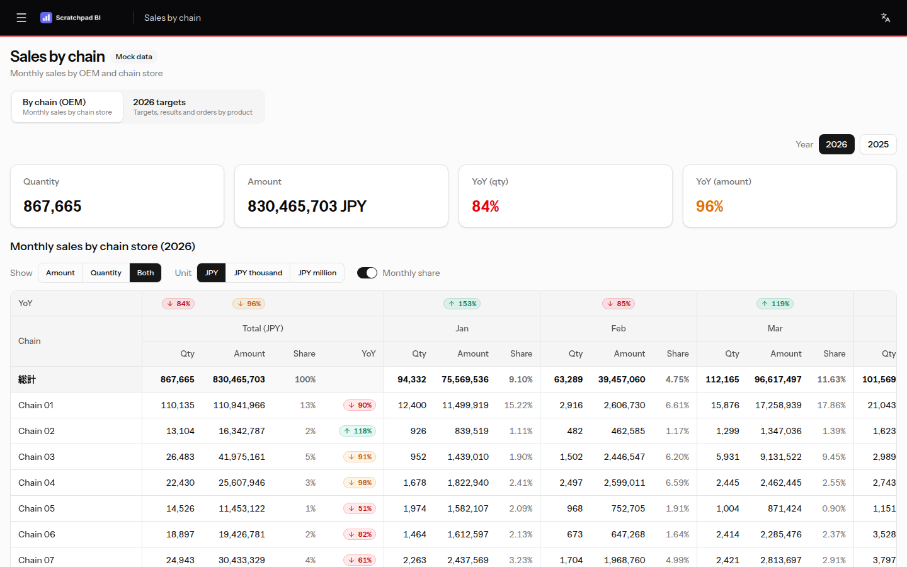
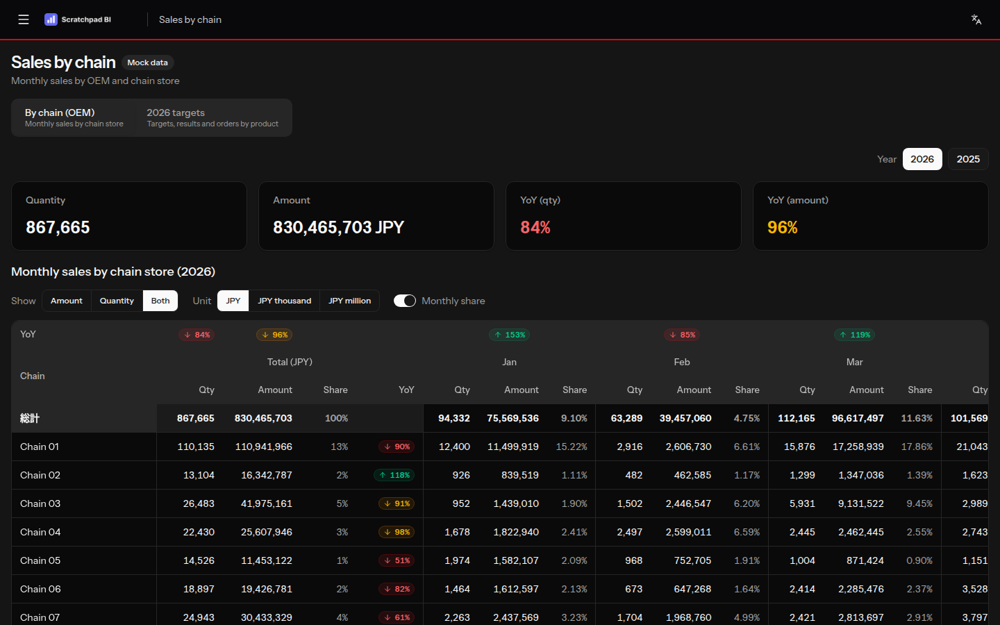
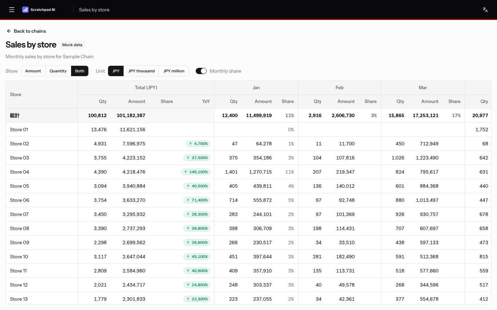
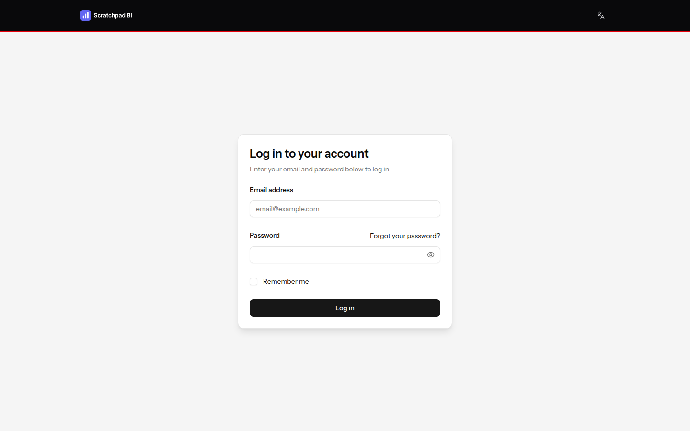

<div align="center">


# Scratchpad BI

Ứng dụng web Business Intelligence (BI) trên nền Laravel, Inertia và Vue, chạy hoàn toàn bằng Docker Compose.

[](LICENSE)


[English](README.md) · **Tiếng Việt** · [日本語](README.ja.md)

</div>

## Mục lục

- [Tính năng](#tính-năng)
- [Ảnh chụp màn hình](#ảnh-chụp-màn-hình)
- [Công nghệ](#công-nghệ)
- [Bắt đầu nhanh](#bắt-đầu-nhanh)
- [Yêu cầu](#yêu-cầu)
- [Cổng host](#cổng-host)
- [Lệnh hằng ngày](#lệnh-hằng-ngày)
- [Cấu trúc thư mục](#cấu-trúc-thư-mục)
- [Thiết lập AI tooling](#thiết-lập-ai-tooling)
- [Xử lý sự cố](#xử-lý-sự-cố)
- [Đóng góp](#đóng-góp)
- [Giấy phép](#giấy-phép)

## Tính năng

- Trang báo cáo doanh số theo chuỗi cửa hàng, cửa hàng và sản phẩm (`/dashboard`, `/sales/stores`, `/sales/products`).
- Bảng BI dạng HTML table với cột sticky và cuộn ngang, màu theo ngữ nghĩa (positive, negative, warning, neutral, actual, target, forecast).
- Xác thực bằng Laravel Fortify: đăng nhập, đặt lại mật khẩu, xác minh email, xác thực hai yếu tố (2FA).
- Trang cài đặt: hồ sơ, bảo mật, giao diện (sáng/tối).
- Đa ngôn ngữ giao diện: tiếng Nhật (mặc định) và tiếng Anh.
- Môi trường phát triển một lệnh: `make setup`.

## Ảnh chụp màn hình

Dữ liệu trong ảnh là dữ liệu giả (mock), tên chuỗi, cửa hàng và sản phẩm đã được ẩn danh.



| Giao diện tối | Doanh số theo cửa hàng |
| --- | --- |
|  |  |



## Công nghệ

| Lớp | Công nghệ |
| --- | --- |
| Backend | Laravel 13, PHP 8.3+, Laravel Fortify, Laravel Wayfinder |
| Frontend | Inertia 3, Vue 3 (TypeScript), shadcn-vue (reka-ui), Tailwind CSS 4, vue-i18n, Vite |
| Dữ liệu | MySQL 8.4, Redis 7 (cache, session, queue) |
| Hạ tầng | Docker Compose, `make` |

## Bắt đầu nhanh

```bash
git clone https://github.com/nhhthong/scratchpad-bi.git
cd scratchpad-bi
make setup
```

`make setup` làm lần lượt:

1. Tạo `.env` từ `.env.example`, điền `UID`/`GID` của bạn và mật khẩu ngẫu nhiên cho MySQL, Redis (nếu đã có `.env` thì giữ nguyên).
2. Kiểm tra cổng host còn trống.
3. Build image, cài `vendor/` và `node_modules/`, tạo `APP_KEY`, chạy migration.
4. Bật stack.

Lần đầu mất vài phút (tải image và dependency). Sau đó mở <http://localhost:8090> (đổi cổng nếu bạn đã sửa `APP_PORT`).

Nếu `vendor/` hoặc `node_modules/` thuộc root (do `UID`/`GID` sai khi cài lần đầu), chạy `sudo chown -R $(id -u):$(id -g) vendor node_modules`, sửa `UID`/`GID` trong `.env`, rồi `make build` và cài lại.

## Yêu cầu

| Công cụ | Dùng để | Ghi chú |
| --- | --- | --- |
| Docker + Docker Compose v2 | Chạy toàn bộ stack | Đã kiểm thử: Docker 29.8.2, Compose 5.6.0 |
| `make`, `openssl`, `ss` | `Makefile` (setup, lệnh tắt) | Có sẵn trên Ubuntu |
| Git | Clone repo | |
| Node.js (có `npx`) | Chỉ để chạy MCP `shadcn` | Tùy chọn. Đã kiểm thử: 24.x |
| Claude Code | AI agent | Tùy chọn. Cần ≥ 2.1.277 để đọc `AGENTS.md` |

Không cần cài PHP, Composer hay pnpm trên host: mọi lệnh chạy trong container. `vendor/` và `node_modules/` được bind-mount từ host nên IDE đọc trực tiếp, đúng bản cài trong container.

> [!NOTE]
> Cấu hình bind-mount này chỉ dành cho Linux. Trên macOS hoặc Windows hãy đổi sang named volume, vì binary native (`esbuild`, `rollup`) khác hệ điều hành và bind-mount chậm.

Stack có 3 container, không tự chạy khi bật máy (`restart: 'no'`):

| Container | Chạy gì |
| --- | --- |
| `bi-ygk-app` | `php artisan dev`: web server, queue worker, log (Pail) và Vite trong một container, tự khởi động lại tiến trình bị crash |
| `bi-ygk-mysql` | MySQL 8.4, dữ liệu trong volume `bi-ygk_mysql_data` |
| `bi-ygk-redis` | Redis 7 cho cache, session, queue (không lưu xuống đĩa) |

## Cổng host

Giá trị mặc định nằm trong `.env`:

| Service | Cổng host | Biến |
| --- | --- | --- |
| App (web server) | 8090 | `APP_PORT` |
| Vite dev server / HMR | 5180 | `VITE_PORT` |
| MySQL (chỉ `127.0.0.1`) | 3310 | `MYSQL_FORWARD_PORT` |
| Redis (chỉ `127.0.0.1`) | 6380 | `REDIS_FORWARD_PORT` |

`make ports` kiểm tra 4 cổng trong `.env` (`make setup` tự chạy bước này). Nếu trùng thì đổi trong `.env`, không dừng service khác. Các container gọi nhau bằng tên service (`mysql:3306`, `redis:6379`), không dùng cổng host.

## Lệnh hằng ngày

`make help` liệt kê toàn bộ. Thường dùng:

```bash
make up            # bật stack
make down          # tắt stack (giữ dữ liệu)
make ps            # trạng thái container
make logs          # log server, queue, Pail, Vite
make shell         # vào bash trong container app
make test          # test PHP (SQLite :memory:, không đụng MySQL)
make types         # kiểm tra kiểu TypeScript
make check         # lint + format
make build-assets  # build production
make migrate       # chạy migration
make mysql         # MySQL shell
make restart       # khởi động lại app (sau khi sửa vite.config.ts hoặc .env)
```

Thêm package:

```bash
docker compose exec app composer require <pkg>
docker compose exec app pnpm add <pkg>
```

Source nằm trên host và được bind-mount vào container, sửa file là thấy ngay. Vite HMR hoạt động không cần polling; chỉ đặt `VITE_USE_POLLING=true` khi HMR bỏ sót thay đổi.

Sau khi sửa `vite.config.ts`, chạy `make restart`: Vite tự restart nội bộ nhưng mỗi lần giữ lại khoảng 200 MiB RAM không giải phóng.

> [!WARNING]
> Không chạy `docker compose down -v`, `docker volume rm` hay `docker system prune` trên volume `bi-ygk_mysql_data`: mất dữ liệu MySQL.

## Cấu trúc thư mục

Dùng thư mục chuẩn của Laravel và Vue.

```text
app/{Actions,DTOs,Enums,Http,Models,Policies,Services}
resources/js/{pages,layouts,components/{ui,tables,shared},composables,lib,types,utils}
docker/php/Dockerfile     compose.yaml     Makefile     .env.example
.claude/{rules,settings.json}     .mcp.json     AGENTS.md
```

## Thiết lập AI tooling

Phần này tùy chọn, dành cho dev dùng Claude Code. Đã commit sẵn, tự có sau khi clone: `AGENTS.md`, `.claude/rules/`, `.claude/settings.json`, `.mcp.json`, `config/boost.php`.

1. Sinh skills của Laravel Boost (không có trong git). Chỉ dùng `--skills`:

   ```bash
   docker compose exec app php artisan boost:install -n --skills
   ```

   Không thêm `--guidelines` (sẽ ghi khối Boost dài vào `AGENTS.md`) và không thêm `--mcp` (sẽ ghi đè mục `laravel-boost` trong `.mcp.json` về `php artisan boost:mcp` chạy trên host, không chạy được).

2. Mở Claude Code ở thư mục gốc repo, chạy `/mcp`, phê duyệt hai server khi được hỏi:
   - `laravel-boost`: chạy trong container `app` (`docker compose exec -T app php artisan boost:mcp`). Cần stack đang chạy.
   - `shadcn`: chạy `npx shadcn-vue@latest mcp`. Nếu từng từ chối, chạy `claude mcp reset-project-choices` rồi mở lại.
3. Chạy `/memory` để xác nhận `AGENTS.md` và các file trong `.claude/rules/` đã được nạp.

`boost.json` và `.claude/skills/` được sinh tự động và nằm trong `.gitignore`. Rule `ask` trong `.claude/settings.json` sẽ hỏi trước khi chạy lệnh phá hủy (`docker compose down`, `docker volume rm`, `docker system prune`, `migrate:fresh`, `db:wipe`, `FLUSH*`).

Tùy chọn: dùng MCP `codebase-memory-mcp` để đánh index mã nguồn (`index_repository`). Index nằm trên máy mỗi người, không có trong repo.

## Xử lý sự cố

| Triệu chứng | Cách xử lý |
| --- | --- |
| `port is already allocated` | Đổi cổng tương ứng trong `.env`, rồi `make up` |
| Lần bật đầu tiên chậm (~1 phút) | `php artisan dev` tải `@laravel/multiplex` qua `pnpm dlx` một lần, cache trong volume `bi-ygk_app_cache`; các lần sau khoảng 2 giây |
| Trang trắng, thiếu CSS/JS | `make logs` (dòng `vite │`); kiểm tra `public/hot` là `http://localhost:<VITE_PORT>` |
| File tạo trong container thuộc root | Đặt đúng `UID`/`GID` trong `.env`, rồi `docker compose build` |
| `laravel-boost` không kết nối trong `/mcp` | Chạy `make up`; chạy thử `docker compose exec -T app php artisan boost:mcp` |
| Mất mật khẩu MySQL sau khi đổi `.env` | MySQL chỉ đọc mật khẩu lúc tạo volume lần đầu; đổi bằng SQL, không sửa `.env` |

## Đóng góp

Đóng góp được hoan nghênh.

1. Fork repo và tạo nhánh từ `main`.
2. Chạy lệnh trong Docker, không chạy `php`, `composer`, `pnpm` trên host (xem [AGENTS.md](AGENTS.md)).
3. Trước khi mở pull request, chạy `make test`, `make types` và `make check`; cả ba phải pass.
4. Mô tả rõ thay đổi và lý do trong pull request.

## Giấy phép

Phát hành theo giấy phép MIT. Xem [LICENSE](LICENSE).
